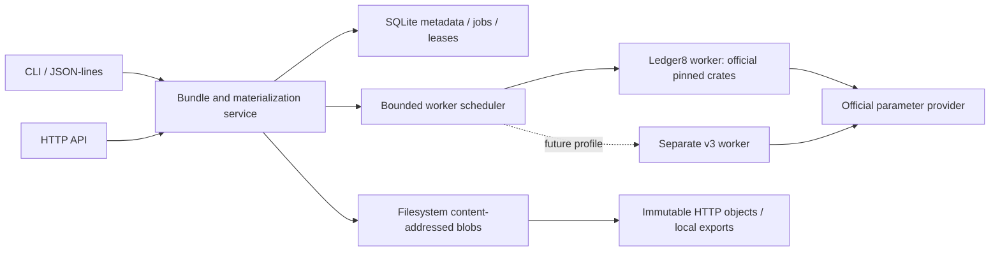

# Midnight ZKIR Forge

## Product and engineering specification

Status: proposed scope for a new, independent repository. Research checked 2026-10-15 (Asia/Kuala_Lumpur). No service implementation or compatibility qualification is claimed.

**Suggested repository:** `midnight-zkir-forge`  
**Suggested binary:** `midnight-zkir-forge`  
**Purpose:** register Midnight ZKIR bundles, derive circuit artifacts once for an exact compatibility profile, and deliver the original ZKIR and derived files over HTTP or the local filesystem.

The name describes an artifact depot, rather than a proof-generation server. Repository, package and domain-name availability have not been checked.

## 1. Requested capabilities

| Requirement | Contract |
| --- | --- |
| Accept a ZKIR bundle | Import one or many named circuits with exact input bytes and a versioned manifest. |
| Generate keys lazily or eagerly | Derive selected circuits on demand, or enqueue all circuits. Deduplicate identical derivations. |
| Serve artifacts | Supply `.zkir`, `.bzkir`, `.prover` and `.verifier` through immutable HTTP URLs and materialized local paths. |
| Reclaim storage | Evict derived files while retaining source and identity; separately purge a bundle and its owned references. |
| Carry metadata | Store producer/tool versions, tags and optional contract sources or source hashes. Distinguish submitted claims from observed generation provenance. |
| Run anywhere appropriate | Rust library, local CLI, JSON-lines stdin/stdout mode and HTTP service share the same application logic. Later support persistent build caches and hosted registry operation. |

The first usable slice must accept one real circuit, generate its artifacts using the pinned official backend, return usable paths, demonstrate a cache hit, and evict/regenerate safely. Grow from that slice.

## 2. Repository and upstream compatibility decision

**Build a separate repository.** Depend on official Midnight crates and reuse their parser, circuit implementation, key generation and serialization. Do not copy cryptographic implementations into the service. Fork an upstream repository only for a demonstrated missing API or bug; document and keep that patch small.

### Initial compatibility profile

Use the latest stable official ledger8 release, verified on 2026-10-15 as **8.1.3**, as the first implementation target. This owner amendment supersedes the original 8.0.3 research baseline. Resolve and lock a consistent official graph and qualify it with real fixtures. The selected versions follow the official ledger-8.1.3 lockfile:

| Component | Initial version |
| --- | --- |
| Compatibility baseline | `midnight-ledger` 8.1.3 |
| `midnight-zkir` | 2.1.1 |
| `midnight-transient-crypto` | 2.1.1 |
| `midnight-base-crypto` | 1.0.2 |
| `midnight-serialize` | 1.1.1 |
| `midnight-proofs` | 0.7.1 |
| `midnight-circuits` | 6.1.0 |
| `midnight-curves` | 0.2.0 |
| `midnight-zk-stdlib` | 1.1.0 |

A service that only needs key generation need not depend on the entire ledger crate. Include it for compatibility tests or integrations only when required.

The split `midnightntwrk/midnight-zkir` repository currently has default branch `zkir-v3`. At commit `33fda96d423496166a891043449ecde1c22f513c`, its crate is 3.1.0-rc.1 and declares transient-crypto 3.0.0, proofs ^0.8.1, circuits ^7.2.4 and zk-stdlib ^2.3.5. Its `main` branch also uses the newer family. These are not drop-in replacements for the initial pinned graph. See the [upstream crate manifest](https://github.com/midnightntwrk/midnight-zkir/blob/33fda96d423496166a891043449ecde1c22f513c/zkir/Cargo.toml) and [workspace dependency patches](https://github.com/midnightntwrk/midnight-zkir/blob/33fda96d423496166a891043449ecde1c22f513c/Cargo.toml).

Do not infer ledger8 compatibility from the shared crate name, a successful parse, or a branch named backwards compatibility. Require end-to-end fixture evidence. A future v3 profile should use a separately built worker/dependency graph when versions conflict. No implicit fallback, migration or format conversion between profiles.

### Reuse official interfaces

The pinned 2.1.1/2.1.1 sources expose `IrSource::load`, the `Zkir` trait with `keygen`/`keygen_vk`, tagged serialization, `ParamsProverProvider`, `Resolver` and `ProvingProvider`. Verify signatures when implementing; these names do not guarantee the same API across releases.

- Backend: use official ZKIR parsing, key generation and serialization.
- Parameters: adapt the official `ParamsProverProvider`; retain upstream parameter verification and record exact parameter identity.
- Consumer integration: provide a small adapter for the official `Resolver`, returning the expected binary IR and matching keys.
- Proofs: reuse an official `ProvingProvider` only for compatibility tests or optional integrations. Generating application proofs is not a core service responsibility.

The [split ZKIR repository](https://github.com/midnightntwrk/midnight-zkir) owns circuit representation/tooling; [midnight-zk](https://github.com/midnightntwrk/midnight-zk) implements the underlying proof system; [midnight-ledger](https://github.com/midnightntwrk/midnight-ledger) supplies the ledger stack. Keep those concerns distinct.

## 3. Core domain model

| Object | Meaning |
| --- | --- |
| `BlobDigest` | SHA-256 of exact stored bytes. No timestamp identity. |
| `BundleId` | Digest of a canonical, versioned circuit inventory: circuit names, input formats and blob digests. |
| `CircuitName` | Validated name within a bundle; never interpreted as an arbitrary filesystem path. |
| `BackendProfileId` | Exact ZKIR/proof-stack implementation, supported format, serialization and generation configuration. |
| `DerivationId` | Exact circuit input plus complete generation recipe, including resolved parameter identity. |
| `ArtifactSetId` | Digest of the actual complete generated output manifest. Distinct from the recipe identity. |
| `BundleViewId` | Immutable mapping of a complete bundle to its profile, per-circuit artifact sets and compatible export layout. |
| `JobId` | One durable attempt to materialize selected derivations. |
| `BundleMetadata` | Descriptions, tags, producer claims, optional sources/hashes, publisher and timestamps. |
| `Alias` | Mutable human name/version/tag resolving to an immutable bundle or view. |

Use Rust newtypes and enums for identities, states, artifact kinds and errors. Avoid interchangeable strings and maps of unvalidated JSON. Keep parsing, persistence, domain decisions and transport adapters separate; do not invent a trait for every helper function.

### Identity rules

1. Hash raw `.zkir` bytes initially. Do not normalize JSON or optimize circuits merely to increase hits. Semantically equivalent inputs are not automatically identical inputs.
2. Define one canonical manifest encoding, schema version and domain-separated hash for each identity. Sort circuit inventories deterministically; reject duplicate names and ambiguous JSON fields. Publish test vectors.
3. Include all generation-affecting options, backend implementation fingerprints, serialization versions and selected public-parameter content identities in `DerivationId`. Human display versions alone are insufficient.
4. Resolve any parameter size/model required by the official backend before finalizing the derivation identity. Never fill missing identity fields with guessed defaults.
5. Labels and optional contract source attachments do not invalidate derived artifacts when circuit bytes and generation inputs are unchanged.
6. Different bundles may reuse an exact derivation. Do not assume the circuit filename is irrelevant if an upstream generation mode embeds it; verify or include it in the recipe.
7. Store uploaded archive digest separately from logical bundle identity, so archive order/compression need not change circuit identity.

Conceptually:

```text
BundleId     = H("midnight-zkir-forge/bundle/v1", canonical(circuit inventory))
DerivationId = H("midnight-zkir-forge/derive/v1", exact input digests,
                 backend implementation + options + serialization,
                 actual parameter-set identity)
ArtifactSetId = H("midnight-zkir-forge/artifacts/v1", canonical(output digests))
```

These are identity contracts, not a claim that upstream key generation always produces byte-identical output. Test reproducibility for each backend profile.

### Verifier identity after eviction

Applications can pin an actual verifier-key digest or `ArtifactSetId`. Never silently replace that identity after regeneration. Preserve small output manifests when evicting large files. If a regenerated set differs, retain it separately and report `artifact_identity_changed`; do not repoint an existing published view. If a profile cannot safely reproduce artifacts, pinned sets must remain retained/exported, or regeneration must explicitly produce a new identity.

## 4. Input bundle and metadata

Accept a directory in local mode and a streamed archive plus manifest over HTTP. Begin with one documented archive format. Detect malformed, duplicate, missing or oversized entries before scheduling key generation.

Example logical input layout:

```text
bundle.json
zkir/increment.zkir
zkir/read.zkir
sources/contract.compact       # optional
```

Example manifest, with digest placeholders for illustration:

```json
{
  "schema": "midnight-zkir-forge.bundle/v1",
  "circuits": [
    {"name": "increment", "format": "midnight-zkir-v2-json",
     "path": "zkir/increment.zkir", "sha256": "<exact-input-digest>"},
    {"name": "read", "format": "midnight-zkir-v2-json",
     "path": "zkir/read.zkir", "sha256": "<exact-input-digest>"}
  ],
  "metadata": {
    "name": "example-counter",
    "tags": ["counter", "ledger8"],
    "producer": {"tool": "compactc", "version": "<observed-or-declared-version>"},
    "contract": {"path": "sources/contract.compact", "sha256": "<source-digest>"},
    "sourceRevision": "<optional-commit>"
  }
}
```

The profile's format label is a service contract, not the Rust crate version. Confirm the actual accepted legacy format in the implementation spike. Each circuit may select an explicitly supported profile; v0.1 may require a single profile family per bundle.

Contract source may be omitted and replaced by a hash-only reference. If source bytes are uploaded, verify their hash. A source hash or producer claim does not prove that the ZKIR was compiled from that source. Keep claimed producer metadata separate from server-observed backend provenance. Generation does not execute uploaded contracts, scripts or binaries.

Support metadata at bundle and individual circuit/file level, including per-circuit producer/tool versions, tags and source references. A circuit inherits bundle defaults; explicit circuit fields override those defaults. Keep observed artifact-generation provenance on each artifact set. Metadata updates do not change exact input bytes or already pinned generation identities.

Store namespaced extensible metadata with size limits. Arbitrary metadata is not an executable configuration channel. Tag changes are audited metadata revisions; immutable bundle/view identities remain stable. Inspect unknown tool versions explicitly rather than claiming universal compatibility.

## 5. Key-generation and cache lifecycle

Support three modes:

- **Register only:** store and inspect circuits without generating keys.
- **Lazy:** register now; materialize a requested circuit on an explicit ensure/resolve request.
- **Eager:** materialize every circuit in the bundle.

State per derivation attempt:

```text
Missing → Queued → Running → Ready
                    ├────→ Failed
                    └────→ Cancelled
Ready → Evicted → Queued
```

An immutable artifact-set record and its current blob availability are separate concepts. A failed/cancelled attempt is not a usable cache entry. Retry is explicit and creates/records an attempt; do not loop endlessly or conceal errors.

### Materialization algorithm

1. Validate bundle/circuit/profile and read authenticated current input objects.
2. Resolve generation recipe and required public parameters; compute final derivation identity.
3. On a verified ready hit, return references without key generation.
4. Otherwise acquire a store-wide derivation lease. Concurrent HTTP/CLI processes join the same job or wait; an in-process mutex alone is insufficient.
5. Generate in a unique worker staging directory using the pinned official backend. Do not let a tool write alongside the immutable source object. The legacy CLI can emit `.bzkir` next to its input, so stage a private input copy if using it.
6. Validate output completeness, serialization/readability where supported, hashes and profile association. Publish `.bzkir`, `.prover` and `.verifier` together as a complete set.
7. Atomically publish immutable objects, then commit the visible ready manifest. Crash recovery must not expose partial sets. Orphan temporary files are reclaimable.
8. Record sizes, digests, backend/parameter provenance, timing, attempt identity and validation scope. Release the lease on success/failure.

Use fresh read-time integrity checks appropriate to immutable cache objects. Hashes are not a justification for trusting modified objects, filename-only hits or timestamps. Cache artifacts, not test outcomes, application proofs or assertions.

Public parameters are a separately managed upstream resource, not reuploaded with every circuit. Use configured providers and verified parameter content. Offline mode reports missing parameters explicitly; network access for parameter retrieval is configurable and visible.

## 6. Runtime architecture



Start with one host, filesystem blobs and SQLite metadata. Do not start with Kubernetes, a message broker, distributed locks, an object-store abstraction hierarchy or multi-region replication. Add a small interface at the boundaries where tests or the future storage backend need it.

Suggested organization (adjust if a smaller layout is clearer):

```text
src/domain/       # IDs, manifests, states, validation, errors
src/application/  # import, ensure, resolve, export, evict, purge
src/store/        # filesystem objects, SQLite, leases, recovery, GC
src/backend/      # pinned official ZKIR adapter and worker protocol
src/transport/    # CLI, JSON-lines, HTTP
src/bin/          # public entry point, private worker if needed
schemas/
fixtures/
tests/
docs/adr/
```

Keep HTTP and local transports thin. Rust errors must preserve the underlying cause and add bundle/circuit/profile/job context, without leaking server paths to remote callers.

### Parallelism

Async is appropriate for HTTP, streaming and orchestration. Circuit compilation/key generation must not block HTTP executor threads. Use a bounded worker process or blocking worker facility, with explicit CPU/memory budgets. Processes provide useful cancellation and version isolation; a single separately built backend worker is sufficient initially.

Worker count is configurable and measured, not a hard-coded assumption that more workers always improve latency. Preserve one immutable parameter cache and isolated mutable staging directories. Track queue time separately from generation time. Establish crash/stale-lease recovery and fencing before claiming reliable background operation. For v0.1, full jobs can be durable in SQLite while a single local supervisor executes them; every writer follows the same leases and lifecycle rules.

## 7. CLI and stdin/stdout interface

Illustrative commands define desired behavior; names can be refined during implementation:

```sh
midnight-zkir-forge import ./bundle --profile ledger8-8.0.3 --mode lazy
midnight-zkir-forge ensure <bundle-id> --circuit increment --wait
midnight-zkir-forge ensure <bundle-id> --all --wait
midnight-zkir-forge inspect <bundle-id> --json
midnight-zkir-forge resolve <bundle-id> --circuit increment --artifact prover --json
midnight-zkir-forge export <bundle-id> --all --output ./zk-config
midnight-zkir-forge evict <bundle-id> --derived --dry-run
midnight-zkir-forge evict <bundle-id> --derived
midnight-zkir-forge purge <bundle-id> --dry-run
midnight-zkir-forge purge <bundle-id>
midnight-zkir-forge gc --max-bytes <budget> --dry-run
midnight-zkir-forge serve --listen 127.0.0.1:8080
midnight-zkir-forge stdio
```

`ensure --wait` returns after requested artifacts are ready or a typed terminal failure. `resolve` alone does not unexpectedly start expensive work; `resolve --ensure` may combine the two explicitly. `--mode eager` enqueues all circuits and can be combined with `--wait`. Document whether a job needs a running local supervisor or is executed by the invoking command.

`stdio` accepts one versioned JSON request per line and emits one JSON response per line with the same request ID. Logs/progress go to stderr. Errors are structured and do not corrupt stdout. Paths and Unicode names are handled as JSON values, not shell snippets. The future protocol may execute requests sequentially; HTTP need not be running.

```json
{"version":1,"id":"req-1","method":"ensure","params":{"bundleId":"<id>","profileId":"<id>","circuits":["increment"],"wait":true,"location":"absolute"}}
```

Responses identify the exact artifact set and include digest, size, artifact kind, and either URL, absolute path or relative path plus an explicit base directory. Resolve caller-relative input paths against the declared request base or process working directory. Do not reinterpret a path relative to the service's internal storage layout.

Filesystem paths refer to a materialized export with a documented lifetime. Persistent exports are owned/pinned until explicit release/removal. Temporary exports return a lease/lifetime and cannot be reclaimed while leased. Do not expose fragile internal CAS paths as indefinitely valid local references. Copy files for exports initially; writable hardlinks could corrupt the shared cache.

## 8. HTTP contract

Version the API and publish OpenAPI documentation. API authentication and namespace authorization apply to all state-changing operations in hosted mode. Local mode binds loopback by default.

| Method and route | Behavior |
| --- | --- |
| `POST /v1/bundles` | Stream a manifest/archive upload. Return bundle identity and registration status; optional eager mode returns job links. |
| `GET /v1/bundles/{id}` | Circuit inventory, metadata revision and per-profile availability. |
| `PATCH /v1/bundles/{id}/metadata` | Authorized metadata update with revision precondition. |
| `POST /v1/bundles/{id}/materializations` | Ensure selected/all circuits under an explicit profile. Return ready references or 202 plus a job URL. |
| `GET /v1/jobs/{id}` | Durable status, progress, errors and completed outputs. |
| `POST /v1/jobs/{id}/cancel` | Request cancellation with defined publication fencing. |
| `GET /v1/bundles/{id}/circuits/{name}/source` | Original uploaded `.zkir` bytes. |
| `GET /v1/objects/{digest}` | Exact immutable artifact bytes, subject to access/retention policy. |
| `POST /v1/bundles/{id}/views` | Publish a complete ready bundle/profile view and return immutable root URL. |
| `GET /v1/views/{id}/...` | Serve provider-compatible layout for that pinned view. |
| `POST /v1/bundles/{id}/evictions` | Evict selected derived content; dry-run supported. |
| `DELETE /v1/bundles/{id}` | Purge owned records/references using a declared in-flight-job policy. |
| `POST /v1/gc` | Authorized maintenance operation with dry-run/budget policy. |
| `GET /health/live`, `GET /health/ready` | Liveness and operational readiness; readiness includes storage/backend configuration. |

Registration may store input before derivation. Distinguish registered, format-validated and materialized states. A ready hit returns 200; scheduling returns 202. Malformed requests use 400/422, unknown identities 404, state/version/pinned identity conflicts 409, quota 413/429, unavailable prerequisites 503. Return a stable error object with `code`, `message`, `requestId`, relevant IDs and retryability.

Expensive lazy generation is explicit through `materializations` or `resolve --ensure`. Do not make ordinary artifact GET silently trigger unbounded computation. A future opt-in on-access endpoint may enqueue a job, but it must return a clear 202 response rather than JSON disguised as a key file. Clients resolve/wait before fetching raw bytes.

### Provider-compatible layout

Expose an immutable view with this structure over HTTP and on disk:

```text
manifest.json
zkir/increment.zkir
zkir/increment.bzkir
keys/increment.prover
keys/increment.verifier
zkir/read.zkir
zkir/read.bzkir
keys/read.prover
keys/read.verifier
```

A complete view is published only when every declared circuit has its exact artifact set. Partial exports, if supported later, must explicitly declare the selected subset. Validate compatibility against the intended versions of `FetchZkConfigProvider`, `NodeZkConfigProvider` and the Rust `Resolver`; do not assume path resemblance is sufficient. The existing [Midnight DID artifact convention](https://github.com/midnightntwrk/midnight-did/blob/main/README.md) uses the same key and binary-IR directories.

Return accurate content length, strong content-digest ETags and appropriate MIME types. Support streaming and resumable large downloads, conditional requests and HEAD. Use long-lived caching only for immutable identities; aliases/metadata need revalidation. An evicted URL can become unavailable, but must never return different bytes under the same identity. Never expose a server-local filesystem path as an HTTP upload input.

## 9. Storage, eviction, purge and recovery

Suggested physical storage:

```text
<root>/metadata.sqlite
<root>/objects/sha256/<prefix>/<digest>
<root>/staging/<job-id>/
<root>/exports/<view-id>/
```

- **Evict derived:** remove eligible large generated blobs; retain original ZKIR, bundle metadata, recipe and small artifact identity manifests. Mark availability honestly; regeneration is possible only with the required backend/parameters and verifier identity rules.
- **Purge bundle:** remove its metadata, optional source attachments, aliases, derivation/view references and owned exports. In-flight writers must be fenced so they cannot resurrect purged data.
- **Shared content:** remove a bundle's references without deleting bytes still referenced by another bundle, view, pin or active lease. Report logical removal and actual reclaimed bytes separately.
- **GC:** reclaim unreferenced or policy-eligible unpinned content using size/age/access policy. Support dry-run, retention pins, explicit storage budget and predictable low-space behavior. Access timestamps guide eviction, never cache validity.
- **Pinned exports/views:** define whether purge is refused or requires an explicit release-pins option. Do not quietly break someone else's retained view.
- **Recovery:** unfinished staging is not ready data. Expired job leases can be recovered with fencing tokens. An old worker cannot publish after a new owner or purge has won.

SQLite transactions coordinate index changes; content publication uses atomic file operations. Document recovery for a crash between object publication and index commit. Physical erasure from backups or storage media is outside an ordinary logical purge guarantee; hosted policies must state their actual scope.

## 10. Operational boundaries

Accepting public circuit input requires bounded input/archive expansion, circuit complexity, generation time, worker memory, disk and concurrent jobs. Validate paths and reject traversal, symlinks, hardlink archive entries and duplicate extraction targets. No user-supplied worker executable, arbitrary remote fetch URL or shell command.

Reuse official parser/serialization limits and verified parameter providers where possible. Record unsupported/invalid/resource failures distinctly. A content digest detects byte changes; it does not identify a trusted publisher. Hosted registry namespaces and writes need authorization. Source attachments are optional and have explicit visibility; do not publish private contract sources merely because derived circuit artifacts are public.

Start observability with structured logs and simple counters: hits/misses, bytes retained/reclaimed, queue/generation latency, active workers, failures and evictions. Record phase timings for import/hash/parse/parameter retrieval/keygen/serialization/publish. Do not claim a latency SLA or minimum hit-rate before measurement.

## 11. Testing and acceptance

Use fast unit/fixture tests for routine development and a small real official-backend integration suite. Fakes verify orchestration, not cryptographic compatibility.

Required acceptance scenarios:

1. One actual ledger8 circuit imports and yields readable `.bzkir`, `.prover` and `.verifier` files through official APIs.
2. A known valid fixture creates and verifies an actual proof using the generated artifacts under the pinned stack. A changed statement/invalid proof fails. No mock verification qualifies this test.
3. Cold generation and a warm identical ensure produce the same pinned artifact references; generation call count is zero on the verified hit. Report cold/warm wall time and clearly scoped peak memory.
4. Eager mode materializes all declared circuits; lazy mode materializes only selected circuits.
5. Exact input, backend, options or parameter changes invalidate the affected derivation. Metadata/tag-only changes do not.
6. Same circuit input/profile reused across two bundles deduplicates safely. Different circuit names only share when name independence is qualified.
7. Concurrent duplicate requests across processes generate once or join a well-defined durable attempt. Unrelated derivations can run within configured budgets.
8. Missing/corrupt/truncated input/output refuses the hit; no partial key pair is served. Tampering is not hidden by timestamps.
9. Worker crash/cancel and stale leases recover without duplicate publication or permanent deadlock.
10. Eviction preserves source and identity manifests; regeneration either reproduces the pinned identity or reports a conflict without silently changing it.
11. Purge during generation fences late publication. Shared objects and another bundle's pins survive appropriately.
12. GC dry-run and actual reclamation agree within documented concurrency limits; active exports/readers are protected.
13. CLI and JSON-lines requests have machine-readable stdout, proper exit/failure behavior and valid absolute/relative-path resolution.
14. HTTP upload,202 scheduling, polling, artifact streaming, HEAD, ETag/conditional fetch and range/resume behavior work.
15. Exported HTTP/filesystem layouts work with the declared JS provider versions and the official Rust resolver adapter.
16. Optional source hashes, uploaded sources, tool claims, observed backend provenance and mutable tags retain their distinct meanings.
17. Malformed archive/path/symlink/duplicate-name/oversize/unsupported-version inputs fail without writes outside managed staging.
18. Full filesystem cleanup and bounded resource failures leave no ready-looking corrupt entries.

A cache hit is not evidence that a test passed. Consumer tests continue running proofs/verifiers/assertions appropriate to their purpose. Retain one uncached key-generation compatibility test so cache reuse cannot conceal a broken generation path. Do not promise speedups for source-authentication-only historical tests that do not invoke key generation.

## 12. Delivery slices

### Slice 0 — Compatibility and identity spike

Resolve the exact ledger8 graph; demonstrate official parse/keygen/serialization plus a real proof fixture. Record the backend profile and whether regeneration is byte-identical. Verify names/IR input format and parameter provenance. Produce one short ADR covering separate repository, version isolation, identity and verifier regeneration.

### Slice 1 — Useful local cache

Rust application/core, filesystem objects, SQLite index/leases, import/ensure/inspect/resolve/export, one-circuit lazy/eager flows, typed errors, integrity checks and actual warm reuse. No HTTP requirement for the first passing slice.

### Slice 2 — Lifecycle and local protocol

Multi-circuit bundles, eviction/purge/GC, crash/cancel fencing, concurrent-process deduplication, metadata/tags/source attachment handling and JSON-lines operation. Document the local cache's ownership and path lifetimes.

### Slice 3 — Single-host HTTP service

Thin API, durable worker supervisor, streamed upload/download, provider-compatible views, OpenAPI, local/hosted authorization modes and container packaging. Demonstrate both JS and Rust consumers without changing their ledger stack.

### Later — Registry and build integration

Namespaced contract releases, optional signed publisher manifests, object storage/CDN and multi-host scheduling when required. Add an opt-in newer ZKIR backend profile in a separate worker build, with separate compatibility tests. Add GitHub cache/export/import examples after local behavior is stable: exact immutable content/profile keys, no secrets/private sources unintentionally exported, and no cached test-pass results. No remote CI deployment is required initially.

## 13. Engineering constraints and handoff

- The new project is independent of Compact's compiler implementation and private Obsidian/evidence paths. Published docs must stand alone.
- Do not modify the protected Compact AST checkout, the recording-effect worktree, its current validation or its goal state.
- Use small domain-oriented modules, readable APIs and targeted tests. Benchmark before optimizing and avoid a large framework.
- Use conventional commits with DCO sign-off and GPG signatures for adopted changes when the environment supports the user's configured signing setup. Never invent a sign-off identity.
- Work locally. No push, merge, hosted deployment or remote CI without user direction.
- Write ADRs for cache identity, version separation, key-regeneration behavior, purge/lease semantics and any material change to integrity guarantees. Do not require five separate ADRs before the first working circuit; split only when the decisions diverge.

## 14. Questions to resolve through the first spike

1. Which official legacy library entry points permit reliable generation and output serialization without shelling out? Prefer a library-backed worker, using the official CLI as an independently pinned comparison where helpful.
2. Is generation byte-reproducible for fixed legacy inputs/parameters/options, and do names affect output? Record results rather than assuming.
3. What public-parameter content identity is actually available from the pinned provider? Name/k alone is not sufficient for the final recipe.
4. What is the smallest real proof fixture and exact consumer-provider version matrix?
5. Which input limits and concurrency budget are practical on the development host? Measure; do not hard-code speculative global performance claims.

## References and evidence boundary

- [Midnight ZKIR repository](https://github.com/midnightntwrk/midnight-zkir): upstream IR and tooling; inspect a pinned revision for each adapter.
- [Split v3 manifest at inspected commit](https://github.com/midnightntwrk/midnight-zkir/blob/33fda96d423496166a891043449ecde1c22f513c/zkir/Cargo.toml).
- [Split v3 workspace dependency patches](https://github.com/midnightntwrk/midnight-zkir/blob/33fda96d423496166a891043449ecde1c22f513c/Cargo.toml).
- [Midnight ledger](https://github.com/midnightntwrk/midnight-ledger) and [Midnight ZK](https://github.com/midnightntwrk/midnight-zk).
- [Midnight DID artifact distribution convention](https://github.com/midnightntwrk/midnight-did/blob/main/README.md).
- [Midnight provider documentation](https://docs.midnight.network/guides/deploy-and-operate).

Legacy baseline/API observations were checked against installed official crates and the existing local ledger8 lockfile. They are implementation starting points, not a claim that Midnight ZKIR Forge has been built or qualified. The protocol, storage layout and APIs above are proposed product decisions, not existing upstream endpoints.

## Owner amendments — 2026-10-15

Latest stable official ledger8 (8.1.3) supersedes the 8.0.3 initial baseline above. Nix is required. Ledger9 and ZKIR3 are deferred. First delivery is a local CLI, default store `~/.midnight-zkir-forge`; all work stays local.

## Local MVP scope

The first implementation is governed by `openspec/changes/local-cache-mvp/`: one circuit per bundle, synchronous CLI and no HTTP/background-job promise. Full service capabilities above remain proposed until separately qualified. Default store: `~/.midnight-zkir-forge`.
