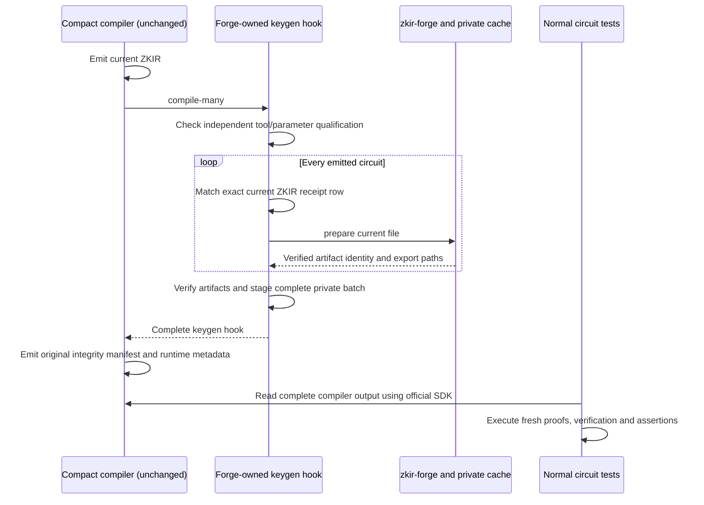

# Passport local compiler key reuse

Status: passed; independently reviewed artifact qualification and fresh native/cold/warm/recovery evidence on native macOS ARM64. The exact cohort is
Compact 0.35.0, Midnight.js providers 5.0.0-rc.2/runtime 0.20.0 and Forge's
separately pinned JSON 3.1 profile. The unchanged account at
`0d7bb0bc834f2d45d9fe2d84c4d022a30d648423` emits 52 circuits. Artifact
qualification covers all 52; application proofs cover `deposit_unshielded` and
`activate_initial_device_with_jubjub`. This does not qualify Linux, all 52
application scenarios or Ledger9 transactions.

## Use a qualified candidate

Build through Nix and retain a checkout-local candidate, without changing PATH,
the shared installation or its cache:

```sh
./bootstrap.sh -- nix build .#default --out-link .local/forge-candidate
./.local/forge-candidate/bin/zkir-forge --version
./.local/forge-candidate/bin/zkir-forge --profile zkir31 profile
```

The tested milestone package is retained separately at
`.local/milestone-2026.10.1/package-root/bin/zkir-forge`. The shared installed
CLI was still 0.2.0 during qualification. Use an absolute binary path from another
directory. JSON 3.0 workers cannot handle this JSON 3.1 cohort. `zkir-forge` is
primary; new installs retain the legacy alias, with primary-name help/version
output. See the command-name compatibility note in the [README](../../README.md).

For this machine's retained qualification inputs, the official compiler is under
`.local/provider-research/compiler` and the verified imported source closure is
under `.local/milestone-2026.10.1/passport/source`, relative to the Forge checkout.
The large compiled outputs and private test caches are intentionally not retained.
These paths are local handoff conveniences, not packaged runtime dependencies.

The [qualification receipt](../evidence/passport-adapter-qualification-local.json)
binds exact compiler, CLI, worker, source, parameter and artifact bytes. Its
independently reviewed raw digest is `4e94e57bf7467a5db580600be3e660691752f363123a1aab2fe8ea92abacc602`. Verify the owning
signed evidence commit and preserve that anchor; a self-reported `status: passed`
is not a trust root. A new build must match every required executable digest or
obtain renewed qualification. Never edit an old allowlist to bless new bytes.
The [local result](../evidence/passport-local-adapter.json) records actual scope,
original compiler inventory, counters, timings and correctness controls.

```sh
./bootstrap.sh -- python3 scripts/compiler-local.py \
  --mode local --compiler-dir /absolute/exact-compiler \
  --binary /absolute/qualified-package/bin/zkir-forge \
  --qualification /absolute/reviewed-qualification.json \
  --qualification-sha256 4e94e57bf7467a5db580600be3e660691752f363123a1aab2fe8ea92abacc602 \
  --params-dir /absolute/verified-parameters \
  --cache-dir /absolute/owned-cache --keygen-timeout-seconds 1800 \
  /absolute/pinned-source/contract/contracts/account.compact /absolute/owned-output
```

Use canonical paths as described in the [adapter guide](local-adapter.md).
The timeout bounds each prepare, including lease waiting, rather than the whole
compile. Default 180 seconds is finite; the explicit range is 1..86400 seconds.
The default store remains `~/.midnight-zkir-forge`, with `--cache-dir` or
`MIDNIGHT_ZKIR_FORGE_DIR` overrides. Use isolated stores for qualification and
destructive recovery controls. Parameters remain verified/offline; no dependency
upgrade or automatic native fallback occurs.

Use native key generation explicitly when needed:

```sh
./bootstrap.sh -- python3 scripts/compiler-local.py \
  --mode off --compiler-dir /absolute/exact-compiler \
  --params-dir /absolute/verified-parameters \
  /absolute/pinned-source/contract/contracts/account.compact /absolute/owned-output
```

This calls the unchanged compiler and does not initialize Forge. Keep this path
available. Unknown emitted circuits, changed tools/parameters/descriptors or
corrupt files refuse local mode.

## Preserve the compiler and tests



The hook is a Forge wrapper, not a shipped upstream compiler flag. Bare Forge
exports are insufficient for these SDKs. The actual compiler owns its complete
output and produces its manifest after successful keygen. Point
`NodeZkConfigProvider` at that output with its independently retained manifest
hash. Keep genuine contract execution, proof generation, verification, assertions
and negative controls running on cold and warm hits. Matching 52 artifact sets
does not mean 52 application scenarios were executed.

## Costs and recovery

The complete native output is 12,184,494,042 bytes across 213 files. A persistent
cache plus copied compiler output requires substantial extra disk; inspect actual
`stats.storage` and keep headroom. Qualification removes its owned reference
stores and lane copies after retaining evidence. Native Nix evidence does not
qualify a clean host without Nix.

One cold/warm observation on this shared host measured a compile-time reduction
of 16.15 minutes (59.8%). It is not a repeated benchmark or a hosted CI result.
Both Forge outputs match all 213 original files.

| Lane | Compiler wall time (s) | Proof-test wall time (s) | Whole lane wall time (s) | Forge requests in this lane |
| --- | --- | --- | --- | --- |
| Native/off | ~1379, timing proxy | 2.892 | Not measured | No Forge cache |
| Cold | 1619.463 | 3.002 | 1628.216 | 52 misses, 0 hits, 0 errors |
| Warm | 650.756 | 2.883 | 659.432 | 52 hits, 0 misses, 0 errors |

Native compilation uses a lower-precision kernel process-start/manifest-mtime
proxy. Cold/warm timers are monotonic; whole lane times also include output
validation and statistics. Proof-test timing includes the SDK execution/assertion
harness, not just the cryptographic prover.

Cold measured key generation totals 926.109 seconds. Warm request time totals
335.898 seconds and estimated avoided generation is 926.109 seconds; warm adds zero
measured generation. These are different measurements, not interchangeable
end-to-end savings. Native/cold/warm plus five positive recovery groups completed
16 fresh proofs, 16 successful verifications, 32 negative proof controls and
144 state/trace assertions across two selected application circuits.

Final post-control statistics contain 113 requests: 58 hits, 53 misses and two
expected injected-corruption errors. The extra miss is controlled regeneration;
the compile lanes themselves have zero errors. Per-file request/byte counters
and storage sizes are retained in the raw receipt.

Read `zkir-forge --cache-dir /absolute/owned-cache stats` before and after tests.
Distinguish per-file logical hits/misses/errors, measured/estimated keygen time,
compiler wall time and complete proof-test wall time. Hits do not count as test
success. Hosted CI savings require separate measurement. The refreshed
selected-two local archive benchmark remains negative: 5.365 seconds
warm-restored versus 4.155 seconds uncached on a shared host. It excludes full
compiler codegen/keygen and internet transfer; do not substitute it for the
full-account in-place result.

A corrupt source, CAS object or export is a hard error. Repair only owned data:
remove an identified owned bad export after refusal, then reconstruct it from
verified CAS. Never wildcard-delete the shared store. Retain verifier identity
through eviction/regeneration. The consumer qualification includes corrupt-CAS
refusal and exact-byte restoration, explicit corrupt-export repair, missing-export
reconstruction, eviction and concurrent callers, with fresh selected SDK proofs
after each recovery. Existing interruption/timeout controls remain separately
described in the adapter guide.

The full account exceeds the current 4 GiB complete HTTP-view budget; its largest
individual file, 495,024,744 bytes, is below 1 GiB. Local Node support does not
imply full-account Fetch support. [#31](https://github.com/betsudo/forge/issues/31)
tracks bounded large-view qualification and an actionable limit error. Until that
gate passes, retain the smaller qualified HTTP fixture. Preserve complete compiler
metadata and existing limits. [Range costs](range-cost.md) are measured separately;
Cloudflare and the hosted CI study remain deferred.

## Renew qualification

The committed `scripts/qualify-passport-local.py` harness requires an already
successful official baseline; it does not create or download that reference.
Read its assertions before running it. The required owned scratch inputs are:

- `.local/milestone-2026.10.1/passport/native-off`: complete output from the
  pinned official compiler using the off command above, with all 52 key pairs.
- `source-inventory.json` beside that output: imported Compact closure at the
  pinned revision, with commit-bound Git blob IDs and SHA-256 values equal to
  the committed full-model evidence. The source tree must match those bytes.
- `native-off-start.json` and `native-off-result.json` beside it: actual process
  start/timing-scope and successful exit records. Preserve actual measurement
  precision; never substitute fabricated timing or a prior run's exit status.
- Exact compiler tools, verified parameters, the qualified candidate and pinned
  integration npm dependencies. Output receipts and scratch targets must be fresh.

The harness compares all 52 official artifact sets before minting a policy, then
runs full cold/warm adapter and recovery lanes. It requires extra free space of
twice the baseline size plus 10 GiB before starting and deletes its explicitly
owned baseline/stores/lane outputs after retaining evidence. Private proof copies
are also removed. Review this cleanup boundary before invoking it.

Final receipts are written only after success and cleanup. Review new source,
tool, parameter and artifact bindings independently, verify fresh genuine proof
counts, then sign and pin the new receipt's raw digest. A receipt for the minimal
fixture or a reduced export carrier cannot authorize the unchanged full account.
