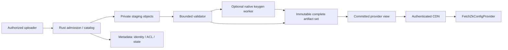

# Hosted artifact delivery: architecture, compression and cost research

Status: proposed research, 2026-10-16. No deployment, vendor account change,
published object, cloud benchmark or production-readiness claim. Prices are
public list-price observations in USD unless stated otherwise; tax, support,
domains, build infrastructure and key-generation compute are excluded from the
illustrations. Reprice before purchasing. Current Forge remains a single-host
filesystem/SQLite application; this is a later service boundary, not an instruction
to place its SQLite database on shared object storage.

## Recommendation

Start a hosted pilot by publishing already qualified immutable artifact sets.
Use a small Rust admission/catalog service, private object storage, a database
containing manifests and authorization metadata, and CDN delivery of immutable
provider views. Keep key generation outside the HTTP request. Existing trusted
CI or an explicitly provisioned worker can publish complete sets; later add a
queue only when measured demand warrants it.

For a small read-heavy service, evaluate **Cloudflare R2 + Workers + D1** first
for low transfer cost. Rust/Wasm is suitable for a lightweight control plane;
it does not establish that the native Midnight cryptography graph builds or runs
inside Workers. For an organization already using AWS, **Rust Lambda + S3 +
DynamoDB + CloudFront** is a conventional alternative. **Cloud Run + object
storage + a catalog database/CDN** is the simplest container-native Rust option
on Google. Azure Functions custom handlers are feasible, but native containers
are worth comparing when handler/runtime complexity outweighs scale-to-zero.
These are shortlisted designs, not a demonstrated global cheapest provider.

The lower-complexity middle tier is one small VM running the existing native
Forge writer, with durable local disk, independently backed-up metadata/objects
and a CDN/object-store publication step. Account for operator time and recovery;
a VM disk is neither a backup nor a globally durable registry.

## Separate admission, generation and delivery



An upload either submits exact ZKIR for explicitly requested generation, or a
complete pre-generated set from an authorized producer. It never becomes a
trusted ready set merely because its manifest is self-consistent. Validate
producer policy, exact backend/worker/parameter identity, input/output lengths
and digests, serialization and consumer qualification. Keep declared compiler
provenance separate from observed Forge generation provenance. Generation uses
a pinned official native worker and verified public parameters, with bounded
CPU/memory/time and one lease per exact derivation.

The catalog stores namespace/owner, source digest, full recipe identity,
artifact-set ID, complete immutable object inventory, authorization, generation
state and audit provenance. Store binary keys in objects, not database rows.
Publish objects first, then conditionally commit a complete manifest/provider
view. Readers can discover only committed views. Retried events are idempotent;
leases require fencing so an expired worker cannot replace a winner. Missing
objects and failed generation remain unavailable, rather than partly ready.

Do not ship parameter files inside a small HTTP function deployment. Cold starts,
parameter downloads, native libraries and memory dominate a generation worker's
startup; measure those separately from steady-state keygen. Prefer direct
size-limited signed object uploads and downloads instead of routing large blobs
through a function/API gateway. Preserve exact source and actual output identity
through eviction and regeneration; a CDN alias must never replace a pinned
verifier identity. No request or proof/witness caching is included here.

## Provider contract and compression

The official name is **FetchZkConfigProvider**, not FetchZKIRProvider. Midnight
separates `zkConfigProvider`, which supplies ZKIR and keys, from `proofProvider`,
which submits proof requests. The official deployment guide describes this
separation. [Midnight provider guide](https://docs.midnight.network/guides/deploy-and-operate)

The package documentation describes these paths relative to its base URL:
`keys/<circuit>.prover`, `keys/<circuit>.verifier`, and
`zkir/<circuit>.bzkir`. ZKIR for this provider is binary `.bzkir`, not the source
JSON `.zkir`. [Official package documentation](https://www.npmjs.com/package/@midnight-ntwrk/midnight-js-fetch-zk-config-provider)

The inspected upstream source on 2026-10-16 also loads an integrity manifest,
verifies artifact bytes with `require` as its default, and can obtain declared
runtime information from the manifest or compiler metadata. Its constructor
options differ from earlier package examples. This source observation at `d1d32aaa24386fce97f653732f8a87c55eb938fe` is
**not** a release/version qualification: pin the consumer's actual package and
source commit during implementation. Preserve the exact compiler-produced
integrity/runtime metadata that consumer requires; a Forge descriptor is not a
substitute. Never disable verification to make a three-file view work. No changes
to Compact or the provider are authorized.
[Official provider source inspected](https://github.com/midnightntwrk/midnight-js/blob/d1d32aaa24386fce97f653732f8a87c55eb938fe/packages/fetch-zk-config-provider/src/fetch-zk-config-provider.ts)

Expose a stable immutable base such as `/views/<view-id>/`; do not translate
mutable circuit names directly into arbitrary object paths. Preserve exact file
names and complete required compiler metadata. Consumers independently pin the
manifest/artifact identity and backend compatibility. Private views require
edge authorization before cache lookup; sharing a CDN object across namespaces
must never share access. Use an authenticated custom fetch where the exact SDK
supports it, or a narrowly scoped signed view URL with expiration. Do not put
long-lived credentials in a provider URL or access logs. Browser qualification
must include exact-origin CORS, preflight where applicable and useful exposed
headers; current Forge HTTP does not already promise this provider-view API.

Compression is a **representation**, not a new artifact identity:

- Keep SHA-256/length of the original serialized key/IR bytes as authoritative.
  Store gzip or Brotli variants only after verifying decompression reproduces
  those bytes. Record compressed-byte digest and length separately. Serving a
  `.gz` filename or a tar archive at `.prover` is not transparent compatibility.
- Negotiate `Accept-Encoding`, use the matching `Content-Encoding`, and send
  `Vary: Accept-Encoding`. Use encoding-specific strong ETags; never equate a
  compressed-body ETag with the canonical artifact hash. The provider's
  `arrayBuffer()` must see the decoded original bytes. Test browser Fetch and
  the exact Node fetch implementation, including a custom fetch if configured.
- `Content-Length` describes transferred representation bytes. HEAD mirrors the
  selected GET representation. No double compression, HTML fallback, CDN byte
  rewriting or stale mixed manifest/key versions. Make immutable cache headers
  appropriate to the view's access policy; metadata aliases have separate TTLs.
- First implementation handles Range requests using the identity representation
  with coherent byte offsets, ETag and `If-Range`; compressed responses advertise
  no range support. A conforming full 200 response may ignore Range, but must not
  emit a 206 with decompressed offsets over a compressed body.
- Upload/decompression limits apply to both compressed and decoded bytes. Private
  content must remain private even when cached, and authorization failures are
  never cached as successful object responses.

Measure compression rather than promising large savings: binary serialized
curve points can already be compact and high entropy, while repeated structural
material may compress well. Keep the identity representation if compression
increases size or CPU cost. Record per-kind raw/gzip/Brotli bytes, levels,
compression CPU time, decoded hash equality, download+decode time and CDN billing
bytes for real DID/passport fixtures. No ratio has been measured for those
consumers in this report. Archive compression for GitHub caches and HTTP content
encoding are separate experiments.

## Cloud feasibility and operating limits

| Option | Rust control plane | Generation placement and relevant boundary |
| --- | --- | --- |
| AWS | Official Rust Lambda runtime support; S3 objects, DynamoDB catalog, CloudFront | Standard Lambda Event Functions: 900-second timeout, up to 10,240 MB memory and `/tmp`, 6 MB synchronous payload; direct object transfer avoids the small buffered API path. Qualify large circuits before considering Lambda keygen; otherwise a native queue worker/container. |
| Google | Native Rust container on Cloud Run; Cloud Run functions runtime support is a separate question | Functions gen2 HTTP duration can reach 60 minutes; other event/time limits differ. Prefer a container/job for native cryptography rather than inventing a managed Rust function runtime. Profile CPU/RAM/parameter download cost and worker timeouts. |
| Azure | Rust through a Functions custom handler (a lightweight HTTP server) | Handler startup must complete within 60 seconds. Hosting-plan duration differs and HTTP response timeout is approximately 230 seconds; asynchronous admission avoids coupling generation to that boundary. Compare Container Apps for a native worker. |
| Cloudflare | Rust/Wasm Worker for validation/admission; D1 metadata, R2 objects | Worker limits and Wasm/native dependency compatibility must be independently qualified. Keep native keygen out of this lightweight layer. CDN object size/cache eligibility also needs checking for the actual largest prover key. |
| Small VM | Existing native CLI/HTTP architecture | One writer is simple; durable backups, bounded jobs, restart recovery, TLS/authentication, patching and disk capacity become operator responsibilities. No serverless timeout, but no automatic durability claim. |

Sources: [AWS Rust](https://docs.aws.amazon.com/lambda/latest/dg/lambda-rust.html),
[AWS quotas](https://docs.aws.amazon.com/lambda/latest/dg/gettingstarted-limits.html),
[Google function quotas](https://docs.cloud.google.com/functions/quotas),
[Azure handler](https://learn.microsoft.com/en-us/azure/azure-functions/functions-custom-handlers),
[Azure hosting/timeouts](https://learn.microsoft.com/en-us/azure/azure-functions/functions-scale),
[Workers limits](https://developers.cloudflare.com/workers/platform/limits/).
These are platform constraints, not measured Forge resource requirements.

## Cost model and observed prices

Use measured values: stored canonical bytes `S`, stored compressed variants `V`,
monthly downloads `N`, transferred bytes `E`, origin-miss fraction `m`, uploads
`U`, catalog reads/writes and CPU/RAM seconds. Then:

```text
monthly cost = object storage(S + V) + object writes(U) + origin reads(N*m)
             + CDN requests(N) + CDN bytes(E) + control-plane requests/CPU/RAM
             + catalog storage/operations + generation + logs/backups/builds
```

Warm CDN hits can reduce object reads; they do not eliminate CDN transfer cost
where a vendor bills it. Compression reduces billed bytes where billing uses
encoded transfer/storage, but retaining both variants increases stored bytes.
Private authentication may add per-request compute; do not silently cost it as
public-bucket traffic. Public-data free tiers may be shared with the organization's
other projects. Credits/promotions are not a permanent architecture advantage.

| Service, observed 2026-10-16 | Price/qualification useful for this decision |
| --- | --- |
| R2 Standard, global service | $0.015/GB-month; Class A $4.50/million; Class B $0.36/million; direct R2 egress free. Monthly free allowance: 10 GB-month, 1 million A, 10 million B. Rounding is per billing unit. |
| Workers Paid | $5/month minimum; includes 10 million requests and 30 million CPU ms; additional requests $0.30/million and CPU $0.02/million ms. Recheck limits and tariff at deployment. |
| D1 Paid | First 5 GB stored, 25 billion rows read/month and 50 million rows written/month included; then $0.75/GB-month, $0.001/million rows read, $1/million rows written. Indexing matters because billing counts rows. |
| AWS Lambda Event Functions, US East (N. Virginia), on-demand first tier | Request $0.20/million; duration x86 $0.0000166667/GB-s, Arm $0.0000133334/GB-s. Shared monthly free tier: 1 million requests and 400,000 GB-s. S3/DynamoDB/CloudFront/logs remain additional, independently priced services. |
| Cloud Run request-based service, Iowa `us-central1`, default on-demand | Active CPU $0.000024/vCPU-s, RAM $0.0000025/GiB-s, requests $0.40/million. Shared free tier 180,000 CPU-s, 360,000 GiB-s, 2 million requests. This is control-plane service pricing, not an entire Google stack quote. |
| Azure Functions | Pricing is region/plan/currency dependent and the fetched page did not yield a dependable numeric regional quote. Obtain an official calculator export for the chosen plan plus Blob, catalog and Front Door/CDN; no invented dollar total or cheapest ranking. |
| Bunny Standard CDN + single-region Standard storage | Storage $0.01/GB-month; CDN Europe/North America $0.01/GB, Asia/Oceania $0.03, South America $0.045, Middle East/Africa $0.06; $1 monthly minimum. Volume CDN first 500 TB $0.005/GB with a smaller network. Control plane/database separate. |
| Hetzner cost-optimized EU VM | CX23 listing: 2 vCPU, 4 GB, 40 GB disk and at least 20 TB included EU traffic. Current page's dynamic price was unavailable; June 2026 price-adjustment table supersedes older widely repeated prices. Obtain a current ex-tax regional quote, IPv4/backups/extra storage included explicitly. |

Primary pricing sources: [R2](https://developers.cloudflare.com/r2/pricing/),
[Workers](https://developers.cloudflare.com/workers/platform/pricing/),
[D1](https://developers.cloudflare.com/d1/platform/pricing/),
[Lambda](https://aws.amazon.com/lambda/pricing/),
[Cloud Run](https://cloud.google.com/run/pricing),
[Azure](https://azure.microsoft.com/en-us/pricing/details/functions/),
[Bunny CDN](https://bunny.net/pricing/),
[Bunny storage](https://github.com/BunnyWay/documentation/blob/main/storage/pricing.mdx),
[Hetzner VM](https://www.hetzner.com/cloud/cost-optimized/),
[Hetzner updated prices](https://docs.hetzner.com/general/infrastructure-and-availability/price-adjustment/).

### Explicit illustrative scenarios

These are arithmetic projections, not measured workloads or total invoices.
Assume no compression benefit, 100 GB-month stored, 10,000 uploads, 100,000
origin reads, 1,000 GB downloaded/month; all applicable free allowances remain
available and tax is excluded. R2 rounds billable storage to 90 GB after its
allowance: **$1.35 storage**, operations within allowance, zero R2 egress. Adding
a Workers Paid control plane yields a **$6.35/month subtotal** if its CPU/request
allowances and D1 included usage suffice. Domains, logs, generation, builds,
backups and any paid authentication are additional. This is not a claim that
private authenticated access can use an unprotected public bucket.

With the same raw storage/transfer assumptions, Bunny single-region storage is
$1/month and Europe/North America Standard CDN is $10/month: **$11 subtotal**
before control plane/database; all-Asia/Oceania transfer would make it $31.
At 50% measured encoded transfer savings, delivery becomes $5 or $15, but keeping
raw plus 50 GB encoded variants increases storage to $1.50. This hypothetical
ratio is deliberately not attributed to Midnight keys.

For lightweight admission only, 100,000 Lambda requests at 256 MiB and 100 ms
consume 2,500 GB-s; before free allowances the x86 compute+request subtotal is
about **$0.062**. Cloud Run at one vCPU/256 MiB for the same cumulative 10,000
active instance seconds plus 100,000 requests is about **$0.2863** before free
allowances. Cold starts, actual memory/CPU sizing, concurrency, database and
object/CDN costs can dominate these tiny numbers; measure rather than selecting
a platform from function invocation price alone.

## Local qualification and decision gates

1. Pin actual consumer packages and official backend graphs for DID 0.7.0 and
   passport; retain real proofs, verification and negative assertions. Publish no
   artifacts or private source as part of this research.
2. Prototype an object/catalog boundary with a local fake object store, failure
   injection and a local HTTP/CDN simulator. Cover duplicate uploads, writer
   death, failed metadata commit, stale lease fencing, corrupt object, missing
   compressed variant, and cross-namespace denial. Existing SQLite is not a
   distributed lease service.
3. Measure complete-set raw/encoded bytes, browser/Node provider parity,
   decompressed identity, actual generation peak RSS/CPU/duration, upload time,
   warm CDN/uncached download time and original consumer test wall time.
4. Recalculate three traffic tiers with regional egress mix, origin-hit ratio,
   authentication, retention, backups and generation frequency. Export official
   vendor calculator inputs, including quotas, billing alerts and hard admission
   limits. Pricing observations above are sufficient to shortlist, not purchase.
5. Obtain independent identity/concurrency review and separate owner approval
   before a hosted pilot, credential provisioning, CI upload or deployment.

The service contract is [hosted-artifact-delivery](../../openspec/changes/hosted-artifact-delivery/proposal.md).


## Tiny-fixture compression observation

A local gzip level 6 probe on the genuine qualification fixtures (2026.10.0,
aarch64-darwin) verified decompressed byte equality. V2 prover bytes grew from
5,309 to 5,332; v3 prover bytes grew from 5,359 to 5,382. Both 1,255-byte verifier keys
compressed to 535 bytes. The tiny binary IR also grew. This directly supports
choosing identity encoding when a variant is larger; it does **not** predict
large DID/passport key compression or CDN savings. No Brotli or HTTP transfer
measurement was made. Receipt: [fixture-compression-local.json](../evidence/fixture-compression-local.json).

To reproduce, prepare the repository's fixtures in a private temporary cache,
read each returned `export.files[*].path`, run Python `gzip.compress(raw,
compresslevel=6, mtime=0)` and assert `gzip.decompress(encoded) == raw`. Record
raw/encoded lengths, decoded SHA-256 and compression time separately. Do not
modify the shared cache or infer consumer compatibility from this probe.
